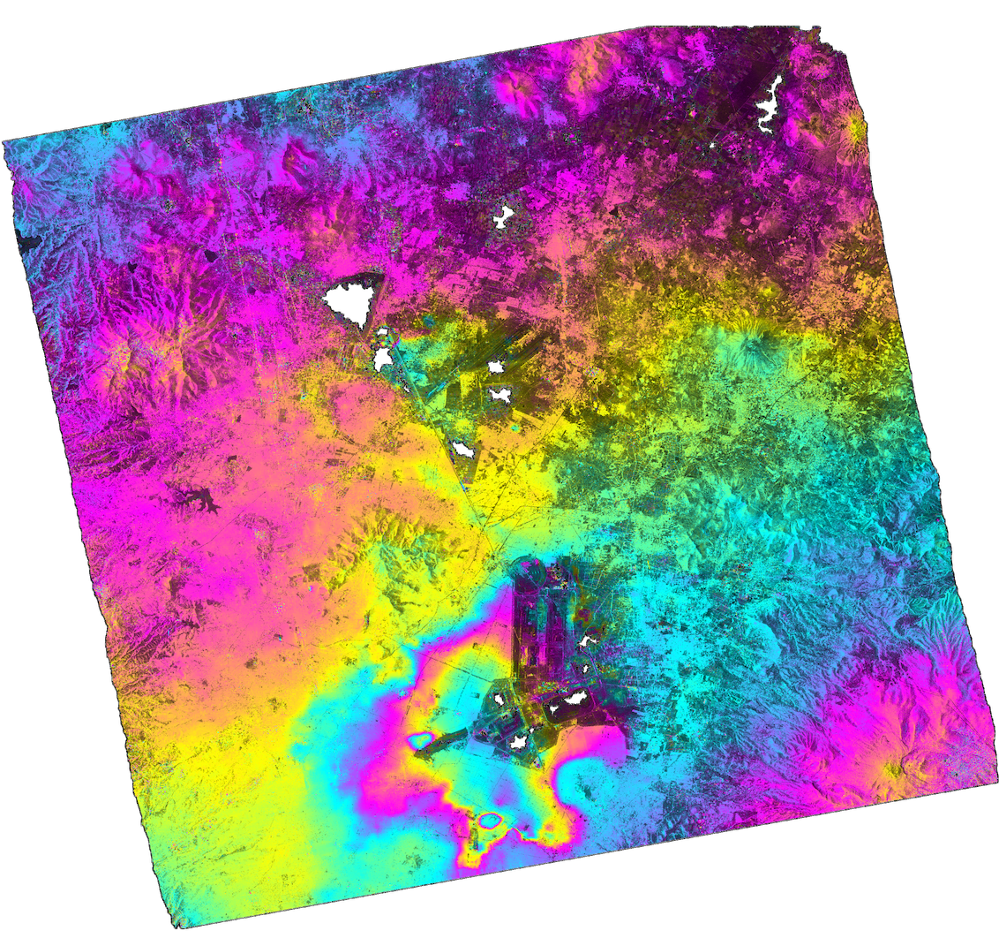

ISCE2 example for processing a single swath of an ALOS-4 interferogram of Ciudad de Mexico. It does not include the ionospheric correction.


You can process ALOS-4 stripmap data with `stripmapApp.py`. HH interferograms have a higher SNR than HV interferograms.

Download the data from ```https://www.eorc.jaxa.jp/ALOS/en/alos-4/a4_data_e.htm```
```
https://s3.ap-northeast-1.wasabisys.com/anonymous-alos4-sample-ap1/ALOS40570380250724FWDPRA0106_1.1__-_ceos.zip?AWSAccessKeyId=U74IB2TN0HDQSBS9WOBA&Signature=Ahztavgs5IJRefJUNLGEapyW03o%3D&Expires=1796515309
https://s3.ap-northeast-1.wasabisys.com/anonymous-alos4-sample-ap1/ALOS40570380260219FWDPRA0106_1.1__-_ceos.zip?AWSAccessKeyId=U74IB2TN0HDQSBS9WOBA&Signature=hqN6TeHMuFLqgz6RHvjII%2Bj19vs%3D&Expires=1796515316
```
Create the input file `alos2App.xml` in the folder `20220905_20230807`. You only need to specify a single swath
```
<stripmapApp>
	<component name="insar">

       <property name="Sensor Name">ALOS4</property>
        <!-- dem.py -a stitch -b 18 20 -100 -98 -r -s 1 -c -u http://step.esa.int/auxdata/dem/SRTMGL1 -f -->
	<property name="demFilename">/Users/francisco/insarproc/cdm/demLat_N18_N21_Lon_W100_W098.dem.wgs84</property>
       <property name="reference doppler method">useDEFAULT</property>
       <property name="secondary doppler method">useDEFAULT</property>
       <property name="range looks">4</property>
       <property name="azimuth looks">12</property>

	<component name="reference">
       <property name="IMAGEFILE">IMG-HH-ALOS40570380250724FWDPRA0106-1.1__-</property>
       <property name="LEADERFILE">LED-ALOS40570380250724FWDPRA0106-1.1__-</property>
       <property name="OUTPUT">reference</property>
	</component>

	<component name="secondary">
       <property name="IMAGEFILE">IMG-HH-ALOS40570380260219FWDPRA0106-1.1__-</property>
       <property name="LEADERFILE">LED-ALOS40570380260219FWDPRA0106-1.1__-</property>
       <property name="OUTPUT">secondary</property>
	</component>

	<property name="filter strength">0.5</property>
	<property name="do unwrap">True</property>
	<property name="unwrapper name">icu</property>
	<property name="geocode list">["interferogram/filt_topophase.unw","interferogram/filt_topophase.unw.conncomp","geometry/los.rdr","phsig.cor","topophase.cor"]</property>
<!--	<property name="geocode bounding box">[-39.6,-39.13,-72.33,-71.74]</property>-->

	<!--for ionospheric correction only-->
    	<property name="do split spectrum">False</property>
    	<property name="do dispersive">False</property>
    	<property name="dispersive filter kernel x-size">800</property>
   	<property name="dispersive filter kernel y-size">800</property>
   	<property name="dispersive filter kernel sigma_x">100</property>
    	<property name="dispersive filter kernel sigma_y">100</property>
    	<property name="dispersive filter kernel rotation">0</property>
    	<property name="dispersive filter number of iterations">5</property>
    	<property name="dispersive filter mask type">connected_components</property>
   	<property name="dispersive filter coherence threshold">0.6</property>
</component>
</stripmapApp>

```


Download the SRTM DEM in the `20220905_20230807/dem_1_arcsec` folder
```
demdem.py -a stitch -b 18 20 -100 -98 -r -s 1 -c -u http://step.esa.int/auxdata/dem/SRTMGL1 -f
```

Run it with
```
stripmapApp.py sm_alos4.xml --steps
```

You should get the following file



